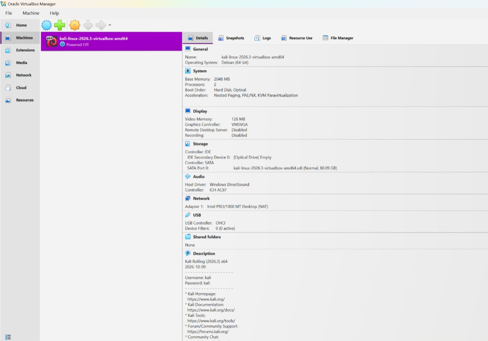
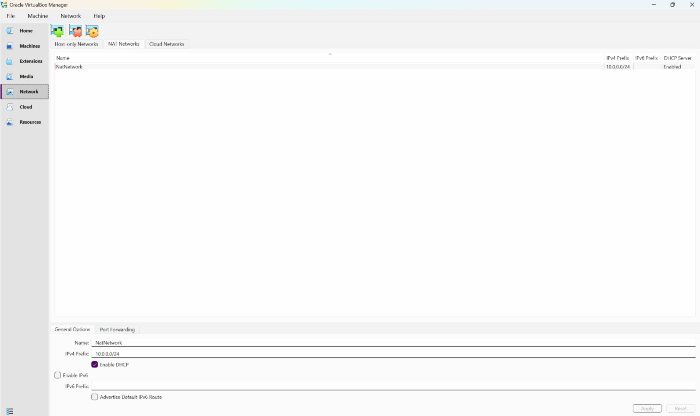
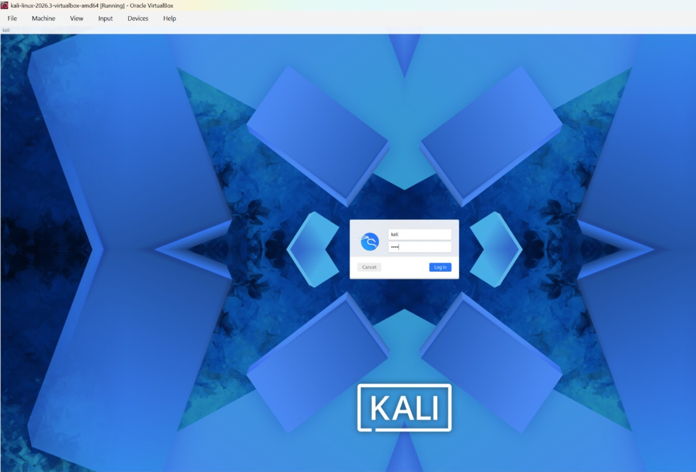
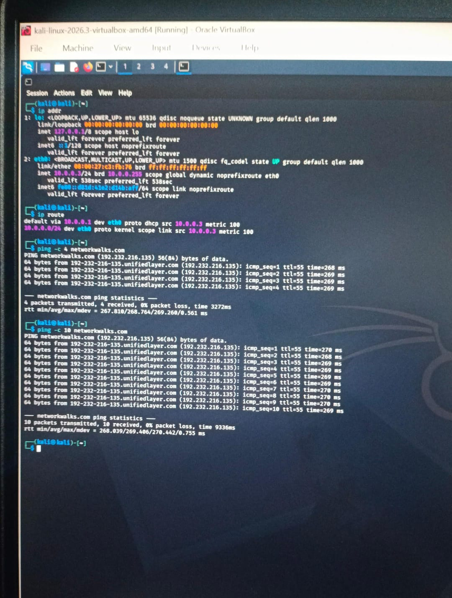

# NetworkWalks BO84 - Week 1: Cybersecurity Lab Setup

A safe practice lab on my laptop using **VirtualBox** and **Kali Linux** (an operating system with security tools). I can learn scanning and testing here without harming real systems.

---

## Lab Setup

| Item | Value |
|---|---|
| Host OS | Windows 11 |
| Hypervisor | VirtualBox |
| Security OS | Kali Linux 2026.3 |
| Kali RAM | 2048 MB |
| Virtual network | NAT Network named `NatNetwork` |
| Network range | 10.0.0.0/24 (DHCP on, IPv6 off) |
| Kali IP | 10.0.0.2/24 |
| Gateway | 10.0.0.1 |
| DNS | 8.8.8.8 |

---

## Steps I Did

1. **Installed VirtualBox.**
2. **Created the NAT Network** (`NatNetwork`, 10.0.0.0/24, DHCP enabled).
3. **Imported Kali** and set Adapter 1 to *NAT Network* -> `NatNetwork`.
4. **Took a snapshot** named `Clean Kali - Network Setup` as a backup.

---

## images of workdone

  

  

  

  

## How I Checked It Works

| Check | Command | Expected result |
|---|---|---|
| IP address | `ip -br a` | `eth0` shows `10.0.0.2/24` |
| Gateway route | `ip route` | `default via 10.0.0.1 dev eth0` |
| Gateway reachable | `ping -c 3 10.0.0.1` | Replies received |
| Internet | `ping -c 3 8.8.8.8` | Replies received |
| DNS | `ping -c 3 Networks.com` | Name resolves, replies received |
| Survives reboot | `sudo reboot`, then `ip -br a` | Same IP and route come back |

---

## What I Learned

- A **NAT Network** lets several VMs talk to each other and still reach the internet.
- A **static IP** makes the lab easier to document.
- A **snapshot** lets me go back to a working state.
- `ip route` and `nmcli device status` help find network problems.
- Writing down problems and fixes is part of a good project.

---

## Tools and Links

- VirtualBox: https://virtualbox.org/wiki/Downloads
- Kali Linux: https://kali.org/get-kali
